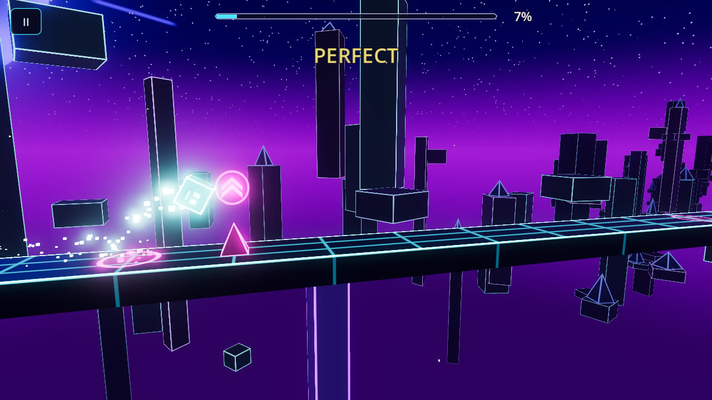
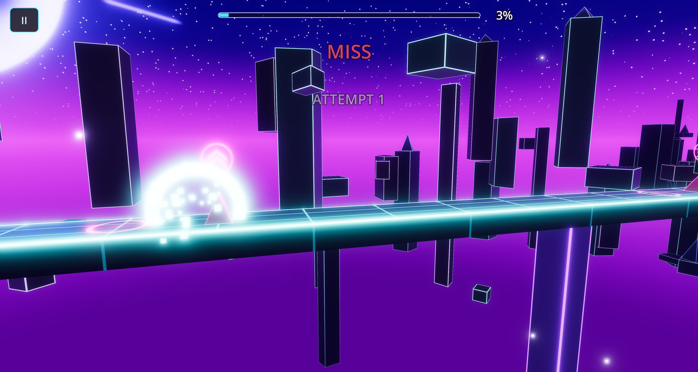
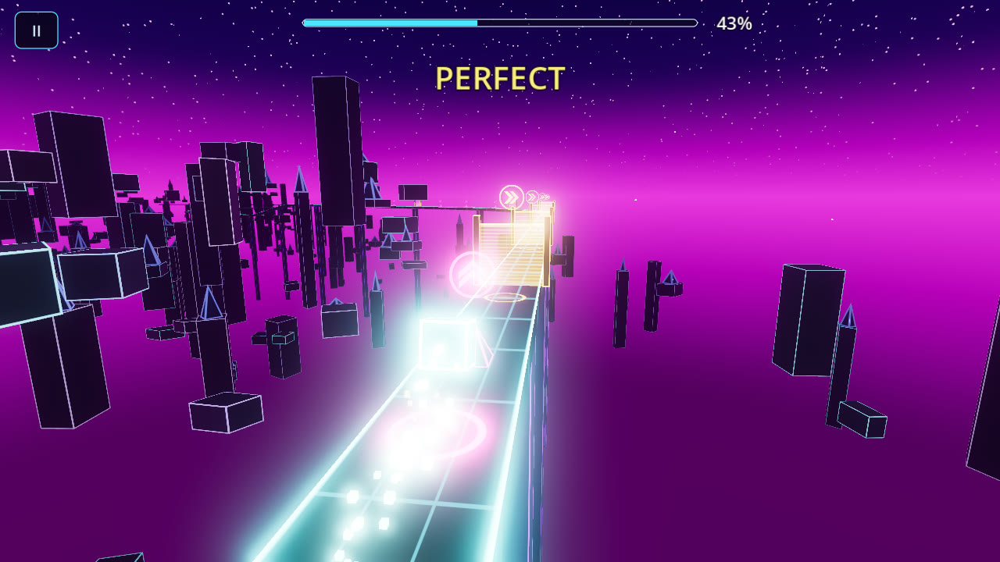
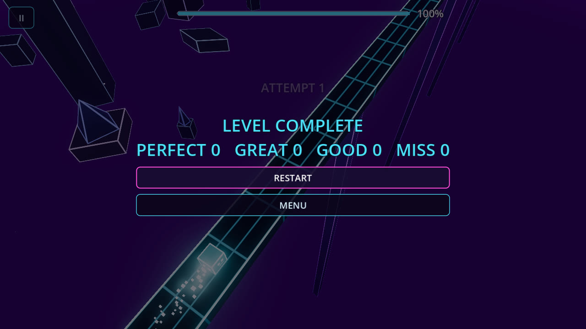
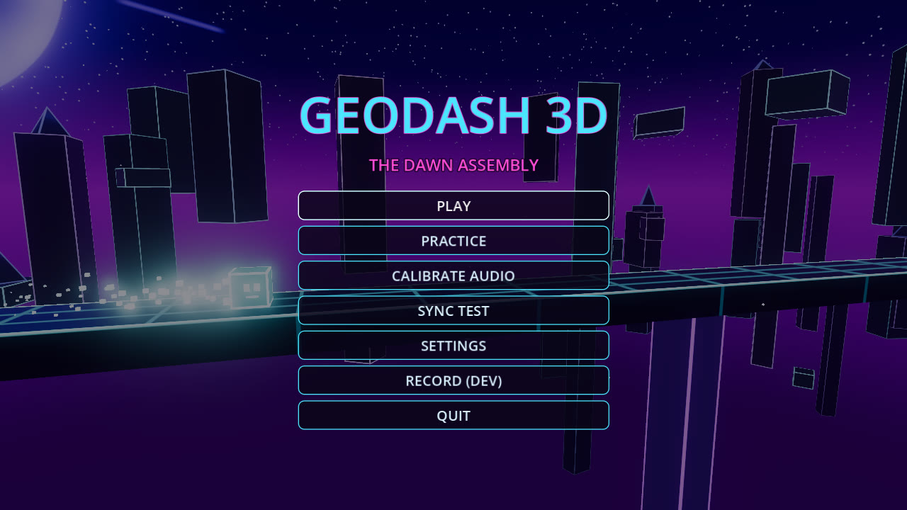

# Âm thanh hiệu ứng (SFX): danh sách và prompt tạo video để tách âm

Quy trình giống dự án zoombieDay: **ảnh đầu vào → Google Flow (image-to-video, có âm thanh) → tải video →
đặt tên theo ID → `tools/audio/build_sfx.py` tự tách âm, cắt, chuẩn hóa, ghi vào game.**
Trong lúc chờ, game dùng âm tạm sinh bằng code (`status: placeholder` trong catalog). Âm thật sẽ tự thay thế khi build.

Ảnh đầu vào nằm trong [`inputs/`](inputs/), được chụp từ chính game bằng tool capture (16:9).

## 0. Quy tắc chung (đọc trước)

**Ưu tiên:** **P1** là bộ cốt lõi cho cảm giác chơi, nên làm trước. **P2** làm sau, gồm các âm cho Phase 4.5
(lách làn, lộn, vật cản vào sân). **P3** là phần trau chuốt.

**Thiết lập video:** 8 giây, **16:9**, chất lượng cao nhất. Mỗi prompt tạo **2–3 take** rồi giữ take có âm sạch nhất,
hoặc giữ cả nếu đều tốt: script sẽ gom biến thể từ mọi take.

**Mẹo lấy âm sạch:**
- Mỗi clip chỉ chứa **một loại âm**, lặp 3–4 lần, cách nhau khoảng 1,5–2 giây. Một clip cho ra 3–4 biến thể để random trong game.
- Luôn có câu **"no music, no speech"**. Model video rất hay tự chèn nhạc nền.
- Camera đứng yên, không cắt cảnh. Mô tả âm đặt **sau** mô tả hình.
- **Âm nên ngắn và ít cao độ** (không thành giai điệu), để không lệch tông với nhạc nền.
  Riêng `run.complete` và `ui.confirm` được phép có cao độ.

**Đuôi gắn vào mọi prompt SFX** (các prompt bên dưới đã ghép sẵn, chỉ cần copy cả khối):
`Static locked-off camera, no cuts, no text, same neon synthwave game style as the image. Audio: only the described sound effects, crisp close-miked futuristic arcade game SFX, no music, no speech, no voice, no ambience, clean silence between sounds.`

**Negative prompt** (nếu công cụ hỗ trợ):
`music, background music, soundtrack, melody, singing, speech, dialogue, narration, voice-over, crowd, camera shake, scene cut, text, subtitles, watermark, distorted audio`

**Đặt tên file tải về:** `art_source/sfx/<ID>_take<N>.mp4`, ví dụ `art_source/sfx/player.jump_take1.mp4`.
Sau đó chạy:
```bash
python tools/audio/build_sfx.py
```
Script in ra những ID đã xử lý và ID còn thiếu, đồng thời tạo trang nghe thử `tools/audio/out/sfx_review.html`.

**License:** chỉ dùng gói có quyền thương mại. Ghi lại tên công cụ, gói và ngày tạo; script lưu sha256 nguồn vào `assets/audio/sfx_manifest.json`.

## 1. Bảng tổng hợp

| # | ID (tên file) | Ưu tiên | Ảnh đầu vào | Dùng khi |
|---|---|---|---|---|
| A1 | `player.jump` | P1 | `in_jump` | nhảy |
| A2 | `player.land` | P1 | `in_jump` | tiếp đất |
| A3 | `player.death` | P1 | `in_death` | khối vỡ |
| A4 | `judge.perfect` | P1 | `in_jump` | chạm PERFECT |
| A5 | `run.checkpoint` | P1 | `in_chase` | qua checkpoint (luyện tập) |
| A6 | `run.complete` | P1 | `in_complete` | hoàn thành màn |
| A7 | `ui.tap` | P1 | `in_menu` | bấm nút |
| A8 | `ui.confirm` | P1 | `in_menu` | bấm PLAY / START |
| B1 | `ui.back` | P2 | `in_menu` | quay lại / đóng |
| B2 | `fx.shockwave` | P2 | `in_chase` | sóng xung kích lúc nhạc drop |
| B3 | `fx.flash` | P2 | `in_chase` | lóe sáng đổi đoạn |
| B4 | `player.dodge` | P2 | `in_chase` | lách làn (GD3-070) |
| B5 | `player.flip` | P2 | `in_chase` | lộn xuống mặt dưới đường (GD3-071) |
| B6 | `hazard.rise` | P2 | `in_jump` | gai trồi lên (GD3-072) |
| B7 | `hazard.drop` | P2 | `in_chase` | tường rơi xuống (GD3-072) |
| B8 | `hazard.unfold` | P2 | `in_chase` | cổng năng lượng bật (GD3-072) |
| C1 | `judge.great` | P3 | `in_jump` | chạm GREAT |
| C2 | `run.attempt` | P3 | `in_chase` | bắt đầu lượt chơi |
| C3 | `ui.pause` | P3 | `in_menu` | tạm dừng |

> Với B4–B8 thì vật cản tương ứng chưa có trong game (Phase 4.5), nên ảnh đầu vào chỉ là cảnh chung.
> Bạn có thể dùng text-to-video với cùng prompt. Khi Phase 4.5 xong, tôi sẽ chụp ảnh đúng cảnh để bạn tạo lại nếu cần.

---

## A. Bộ cốt lõi (P1)

### A1 · `player.jump` · P1
 `inputs/in_jump.jpg`
```
The glowing cyan cube on the neon track hops up into the air four times, about 1.5 seconds apart, each hop leaving a short trail of glowing pixel squares. Sound of each hop: a short, airy synth "whoop" with a quick upward pitch sweep and a soft electronic pop at the start, very short and punchy. Static locked-off camera, no cuts, no text, same neon synthwave game style as the image. Audio: only the described sound effects, crisp close-miked futuristic arcade game SFX, no music, no speech, no voice, no ambience, clean silence between sounds.
```

### A2 · `player.land` · P1
 `inputs/in_jump.jpg`
```
The glowing cyan cube drops and lands firmly on the glass-and-metal neon track four times, about 1.5 seconds apart; each landing sends a small ring of light across the floor. Sound of each landing: a soft, tight electronic thump with a tiny glassy tick on top, dry and short. Static locked-off camera, no cuts, no text, same neon synthwave game style as the image. Audio: only the described sound effects, crisp close-miked futuristic arcade game SFX, no music, no speech, no voice, no ambience, clean silence between sounds.
```

### A3 · `player.death` · P1
 `inputs/in_death.jpg`
```
The glowing cyan cube crashes into a pink crystal spike and shatters into dozens of small glowing pixel shards with a bright flash; this happens three times, about 2 seconds apart, the cube reappearing each time. Sound of each crash: a crisp crystal-glass shatter layered with a short electric zap and digital glitch crackle, ending quickly. Static locked-off camera, no cuts, no text, same neon synthwave game style as the image. Audio: only the described sound effects, crisp close-miked futuristic arcade game SFX, no music, no speech, no voice, no ambience, clean silence between sounds.
```

### A4 · `judge.perfect` · P1
 `inputs/in_jump.jpg`
```
As the glowing cube jumps over the pink spike, a burst of golden sparkles flashes around it; this repeats four times, about 1.5 seconds apart. Sound of each burst: a very short, bright magical shimmer sparkle, airy and high, like tiny glass chimes brushed once, no melody. Static locked-off camera, no cuts, no text, same neon synthwave game style as the image. Audio: only the described sound effects, crisp close-miked futuristic arcade game SFX, no music, no speech, no voice, no ambience, clean silence between sounds.
```

### A5 · `run.checkpoint` · P1
 `inputs/in_chase.jpg`
```
The glowing cube races along the neon track and passes through a glowing green checkpoint light three times, about 2 seconds apart; each time a soft green glow pulses outward. Sound of each pass: a smooth rising airy whoosh ending in a single clean crystalline ping. Static locked-off camera, no cuts, no text, same neon synthwave game style as the image. Audio: only the described sound effects, crisp close-miked futuristic arcade game SFX, no music, no speech, no voice, no ambience, clean silence between sounds.
```

### A6 · `run.complete` · P1
 `inputs/in_complete.jpg`
```
The words LEVEL COMPLETE glow brighter and a wave of cyan and pink light sweeps across the neon track, then everything settles. Sound: one short triumphant retro-futuristic synth fanfare stinger lasting about two seconds, bright and celebratory, with a shimmering tail, followed by complete silence. Static locked-off camera, no cuts, no new text, same neon synthwave game style as the image. Audio: only the described stinger, crisp close-miked game audio, no background music bed, no speech, no voice, no ambience, silence after the stinger.
```

### A7 · `ui.tap` · P1
 `inputs/in_menu.jpg`
```
A finger-press highlight lands on the menu buttons one after another, four times, about 1.5 seconds apart; each button glows briefly when pressed. Sound of each press: a soft, clean, short digital UI click with a gentle glassy bleep, very subtle. Static locked-off camera, no cuts, no new text, same neon synthwave game style as the image. Audio: only the described sound effects, crisp close-miked futuristic arcade game SFX, no music, no speech, no voice, no ambience, clean silence between sounds.
```

### A8 · `ui.confirm` · P1
 `inputs/in_menu.jpg`
```
The PLAY button is pressed four times, about 1.5 seconds apart; each press makes it flash bright pink and pulse outward. Sound of each press: a confident two-tone upward digital bleep, short and bright, like a futuristic confirm sound. Static locked-off camera, no cuts, no new text, same neon synthwave game style as the image. Audio: only the described sound effects, crisp close-miked futuristic arcade game SFX, no music, no speech, no voice, no ambience, clean silence between sounds.
```

## B. Bổ sung (P2)

### B1 · `ui.back` · P2
 `inputs/in_menu.jpg`
```
A highlight slides back off the menu buttons four times, about 1.5 seconds apart, each time the glow dimming. Sound of each: a soft short downward digital bleep, gentle and muted. Static locked-off camera, no cuts, no new text, same neon synthwave game style as the image. Audio: only the described sound effects, crisp close-miked futuristic arcade game SFX, no music, no speech, no voice, no ambience, clean silence between sounds.
```

### B2 · `fx.shockwave` · P2
 `inputs/in_chase.jpg`
```
Three times, about 2.5 seconds apart, a huge ring of cyan light bursts outward from the racing cube and sweeps across the whole neon city. Sound of each burst: a deep, punchy sub-bass boom with a wide airy whoosh tail, cinematic but short. Static locked-off camera, no cuts, no text, same neon synthwave game style as the image. Audio: only the described sound effects, crisp close-miked futuristic arcade game SFX, no music, no speech, no voice, no ambience, clean silence between sounds.
```

### B3 · `fx.flash` · P2
 `inputs/in_chase.jpg`
```
Three times, about 2.5 seconds apart, the whole scene flashes bright white-pink for an instant and the neon colors intensify. Sound of each flash: a short bright swell that rises quickly into a soft airy impact, like a reversed shimmer cut off at the peak. Static locked-off camera, no cuts, no text, same neon synthwave game style as the image. Audio: only the described sound effects, crisp close-miked futuristic arcade game SFX, no music, no speech, no voice, no ambience, clean silence between sounds.
```

### B4 · `player.dodge` · P2
 `inputs/in_chase.jpg`
```
The glowing cube quickly rolls sideways into the next lane of the neon track and back, four times, about 1.5 seconds apart, leaving a brief smear of light. Sound of each sidestep: a quick, tight sideways swoosh with a tiny electronic tick as the cube rolls, short and snappy. Static locked-off camera, no cuts, no text, same neon synthwave game style as the image. Audio: only the described sound effects, crisp close-miked futuristic arcade game SFX, no music, no speech, no voice, no ambience, clean silence between sounds.
```

### B5 · `player.flip` · P2
 `inputs/in_chase.jpg`
```
The glowing cube swings over the edge of the neon track and flips underneath it, then flips back on top, three times, about 2.5 seconds apart. Sound of each flip: a smooth circular whoosh that sweeps around, ending in a soft mechanical magnetic clunk as the cube locks onto the underside. Static locked-off camera, no cuts, no text, same neon synthwave game style as the image. Audio: only the described sound effects, crisp close-miked futuristic arcade game SFX, no music, no speech, no voice, no ambience, clean silence between sounds.
```

### B6 · `hazard.rise` · P2
 `inputs/in_jump.jpg`
```
Four times, about 1.5 seconds apart, a sharp pink crystal spike shoots up out of the neon track floor and locks in place with a small flash. Sound of each spike: a quick crystalline scraping "shing" rising in pitch, ending in a tiny glassy click. Static locked-off camera, no cuts, no text, same neon synthwave game style as the image. Audio: only the described sound effects, crisp close-miked futuristic arcade game SFX, no music, no speech, no voice, no ambience, clean silence between sounds.
```

### B7 · `hazard.drop` · P2
 `inputs/in_chase.jpg`
```
Three times, about 2 seconds apart, a heavy dark block with glowing orange edges falls from the sky and slams onto the neon track, kicking up a ring of glowing dust. Sound of each slam: a deep heavy thud with a metallic clank and a short low rumble, powerful but brief. Static locked-off camera, no cuts, no text, same neon synthwave game style as the image. Audio: only the described sound effects, crisp close-miked futuristic arcade game SFX, no music, no speech, no voice, no ambience, clean silence between sounds.
```

### B8 · `hazard.unfold` · P2
 `inputs/in_chase.jpg`
```
Three times, about 2 seconds apart, a tall lime-green energy gate unfolds sideways across the neon track and its force field switches on with a flicker. Sound of each gate: a fast electric power-up hum that swells for half a second and ends with a crisp zap. Static locked-off camera, no cuts, no text, same neon synthwave game style as the image. Audio: only the described sound effects, crisp close-miked futuristic arcade game SFX, no music, no speech, no voice, no ambience, clean silence between sounds.
```

## C. Trau chuốt (P3)

### C1 · `judge.great` · P3
 `inputs/in_jump.jpg`
```
As the glowing cube jumps over the spike, a small burst of cyan sparkles appears around it, four times, about 1.5 seconds apart. Sound of each: a soft, short, airy sparkle tick, gentler and lower than a bright chime, no melody. Static locked-off camera, no cuts, no text, same neon synthwave game style as the image. Audio: only the described sound effects, crisp close-miked futuristic arcade game SFX, no music, no speech, no voice, no ambience, clean silence between sounds.
```

### C2 · `run.attempt` · P3
 `inputs/in_chase.jpg`
```
Three times, about 2.5 seconds apart, the glowing cube materializes on the neon track in a quick swirl of pixels. Sound of each appearance: a short soft digital materialize sound, a quick rising shimmer of tiny blips. Static locked-off camera, no cuts, no text, same neon synthwave game style as the image. Audio: only the described sound effects, crisp close-miked futuristic arcade game SFX, no music, no speech, no voice, no ambience, clean silence between sounds.
```

### C3 · `ui.pause` · P3
 `inputs/in_menu.jpg`
```
Four times, about 1.5 seconds apart, the screen dims slightly as if the game is paused, then brightens again. Sound of each dim: a soft muffled downward whoosh, short and gentle. Static locked-off camera, no cuts, no new text, same neon synthwave game style as the image. Audio: only the described sound effects, crisp close-miked futuristic arcade game SFX, no music, no speech, no voice, no ambience, clean silence between sounds.
```
